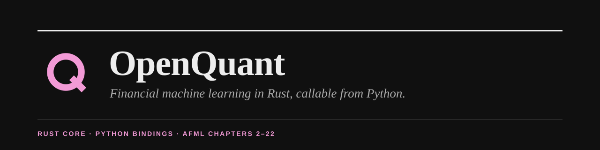

<p align="center">
  
</p>

<h1 align="center">OpenQuant</h1>

<p align="center">
  <strong>Rust implementations of the methods in <em>Advances in Financial Machine Learning</em>, with Python bindings.</strong>
</p>

<p align="center">
  <a href="https://github.com/Open-Quant/openquant/actions/workflows/ci.yml"></a>
  <a href="https://github.com/Open-Quant/openquant/actions/workflows/docs-pages.yml"></a>
  <a href="LICENSE"></a>
</p>

<p align="center">
  <a href="https://open-quant.github.io/openquant/"><strong>Documentation</strong></a>
  ·
  <a href="https://open-quant.github.io/openquant/quickstart/">Quickstart</a>
  ·
  <a href="https://github.com/Open-Quant/openquant/issues">Issues</a>
</p>

## Status
Pre-release (0.1.0, unpublished). The Rust core covers most AFML chapters and is
tested in CI. The [module index](https://open-quant.github.io/openquant/modules/)
lists the current Rust and Python surfaces. The installation below builds from source
so the examples and extension use the same revision. Open work is tracked in
[issues](https://github.com/Open-Quant/openquant/issues); the reasoning behind it is in
`docs/design/production-readiness-brief.md`.

## Install
Requires a Rust toolchain (pinned by `rust-toolchain.toml`), Python 3.11+ and
[`uv`](https://docs.astral.sh/uv/).

```bash
git clone https://github.com/Open-Quant/openquant.git && cd openquant
uv venv --python 3.13 .venv
uv sync --locked --group dev --no-install-project
uv run --no-sync --python .venv/bin/python maturin develop --release --manifest-path crates/pyopenquant/Cargo.toml
uv run --no-sync --python .venv/bin/python python -c "import openquant; print('ok')"
```

The Python distribution name is `pyopenquant`; the import name is `openquant`.
Check the [release notes](https://github.com/Open-Quant/openquant/releases) for packaged
release availability; the commands above do not depend on a published wheel. Do not `pip install openquant` - that name on PyPI belongs
to an unrelated project.
The extension crate (`crates/pyopenquant`) is built into a wheel with maturin and is
never published to crates.io.

## Explore and validate

- [Module index](https://open-quant.github.io/openquant/modules/): available Rust and Python APIs, organized by AFML chapter.
- [Research workflow](docs/research_workflow.md): notebooks, reproducible experiments and promotion criteria.
- [Benchmarks](docs/benchmark_snapshot.md): measured results and their limitations, not investment-performance claims.
- [Agent guide](https://open-quant.github.io/openquant/agents/): source map, research safeguards and validation commands.

```bash
# Core Rust tests (the long-running SADF test has a separate nightly gate)
cargo test --workspace --lib --tests --all-features -- --skip test_sadf_test
```

For the complete test, benchmark and documentation workflow, see
[CONTRIBUTING.md](CONTRIBUTING.md). Release criteria are in the
[publishing checklist](docs/publishing.md). Experimental runners are research
infrastructure, not a trading service or evidence of profitable strategies.

## Contributing
See [CONTRIBUTING.md](CONTRIBUTING.md) for setup, the test and docs gates, and pull
request conventions, and [tests/FIXTURES.md](tests/FIXTURES.md) for where the test
fixtures come from. Report security problems privately ([SECURITY.md](SECURITY.md)).

## License
MIT (`LICENSE`)
